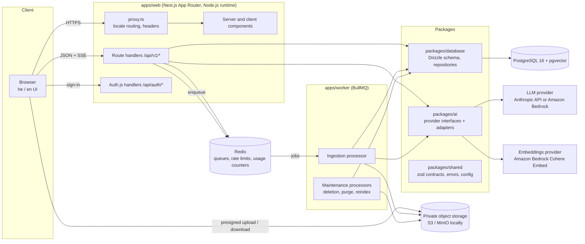

# Architecture

Status: **design**. Nothing in this document is a statement that a component is implemented, tested or deployed. Facts marked "verified" were checked against the cited source on 2026-11-15; everything else is a design decision or an assumption and is labelled as such.

Related documents: `DATABASE_SCHEMA.md`, `RAG_PIPELINE.md`, `SECURITY.md`, `DEPLOYMENT.md`.

## 1. Goals and constraints

- One product, two processes: a Next.js web application (UI and HTTP API) and a background ingestion worker. No microservices.
- Retrieval-augmented generation over tenant-scoped documents, with citations that the server can prove point at retrieved chunks.
- Model providers are replaceable. Model identifiers exist in configuration only.
- A public demo runs against an isolated, read-only organization.
- Simulated output is never presented as live AI output. The RAG workflow is not described as complete until it has run against the real LLM and embedding providers.
- No paid cloud resource is provisioned without the owner's approval.

## 2. Verified platform facts (2026-11-15)

| Topic | Finding | Source |
|---|---|---|
| Next.js | Current major is 16. npm `latest` is 16.4.6 (registry query). 16.3 was announced on 2026-08-03. `engines.node` is `>=20.9.0`. | https://nextjs.org/blog/next-16-3 , `npm view next` |
| Next.js request interception | Since v16.0.0 the `middleware` file convention is deprecated and renamed `proxy`; it runs on the Node.js runtime. The docs state that authorization must be verified inside each Server Function and not rely on Proxy alone. | https://nextjs.org/docs/app/api-reference/file-conventions/proxy |
| React | npm `latest` is 19.3.1. | `npm view react` |
| Tailwind CSS | npm `latest` is 4.3.5 (v4). | `npm view tailwindcss` |
| next-intl | 4.15.1; peer range includes `next ^16.0.0`. | `npm view next-intl` |
| Auth.js | `next-auth` npm `latest` is 4.24.15; v5 is still published under the `beta` tag (5.0.0-beta.32, peer range includes `next ^16.0.0`). The project is maintained by the Better Auth team, which states it will keep addressing security patches and urgent issues and recommends Better Auth for new projects. | https://better-auth.com/blog/authjs-joins-better-auth , `npm view next-auth dist-tags` |
| LLM (Claude API) | Cost-efficient current model: Claude Haiku 5.5, API ID `claude-haiku-5-5`. | https://platform.claude.com/docs/en/models/overview |
| LLM (Bedrock) | Same model on Bedrock: base ID `anthropic.claude-haiku-5-5`; in-Region inference is not supported on `bedrock-runtime`, so an inference profile ID is required (`eu.`, `us.`, `global.` and other prefixes). | https://docs.aws.amazon.com/bedrock/latest/userguide/model-card-anthropic-claude-haiku-5-5.html |
| Embeddings | `cohere.embed-multilingual-v3`, 1024-float vectors, max 96 texts per call, 512 tokens / 2,048 characters per text. | https://docs.aws.amazon.com/bedrock/latest/userguide/model-parameters-embed-v3.html |
| pgvector | 0.8.7; HNSW with `vector_cosine_ops`; `vector` type indexable up to 2,000 dimensions. | https://github.com/pgvector/pgvector |
| BullMQ | Redis must use `maxmemory-policy noeviction`; workers need `maxRetriesPerRequest: null`. | https://docs.bullmq.io/guide/going-to-production |

Details of the model findings are in section 7.3. The Auth.js status is a risk; see section 12 and section 17.

## 3. System overview



The browser never talks to a model provider and never holds provider or AWS credentials. Its only direct contact with object storage is through short-lived presigned URLs issued by the API.

## 4. Monorepo layout

pnpm workspaces (`pnpm-workspace.yaml`: `apps/*`, `packages/*`). Package scope `@hks/*`.

```
apps/
  web/                 Next.js App Router: UI, route handlers, Auth.js, design system
    src/app/[locale]/  locale-prefixed pages (marketing, demo, workspace)
    src/app/api/       route handlers (no locale prefix)
    src/components/    design-system components and feature components
    src/server/        server-only request context, authz, SSE helpers, rate limiting
    src/proxy.ts       next-intl locale routing, security headers, CSP nonce
    messages/          he.json, en.json
  worker/              BullMQ worker process (ingestion, deletion, purge, reindex)
packages/
  ai/                  ChatModelProvider, EmbeddingsProvider, adapters, prompt builder,
                       citation validator, chunker, extraction
  database/            Drizzle schema, SQL migrations, tenant-scoped repositories, seed
  shared/              zod request/response contracts, error codes, config loader, logger
docs/
infrastructure/        docker-compose.yml, Dockerfiles, (later) IaC — design only
```

Dependency rule: `shared` depends on nothing internal; `database` and `ai` depend on `shared`; `apps/*` depend on all three. `packages/ai` does not import `packages/database`: retrieval SQL lives in `database`, orchestration lives in the app that calls both.

**Design system location.** Tokens (CSS custom properties, Tailwind v4 `@theme`) and UI components live inside `apps/web`, because only one application renders UI. A separate package would add build and versioning overhead with no second consumer. If a second UI application appears (for example an admin console), the tokens and components are extracted to `packages/design-system` at that point. This is a deliberate deviation from the structure suggested in the brief.

Extraction and chunking live in `packages/ai` so that the worker, the seed script and the evaluation runner share one implementation.

## 5. Runtime components

| Component | Responsibility | Notes |
|---|---|---|
| `apps/web` | Renders pages; exposes `/api/v1/*`; authenticates; authorizes; orchestrates chat; issues presigned URLs; enqueues jobs | Node.js runtime for all route handlers (database driver, AWS SDK, streaming). Not the Edge runtime. |
| `apps/worker` | Consumes BullMQ queues; extraction, chunking, embedding, persistence; deletion; purge; reindex | Separate process and container. No inbound HTTP except a health port. |
| PostgreSQL + pgvector | System of record and vector index | One database. See `DATABASE_SCHEMA.md`. |
| Redis | BullMQ queues, rate-limit counters, usage counters, idempotency keys | `noeviction` policy; every non-queue key has a TTL. |
| Object storage | Original uploaded files | Private bucket; MinIO locally. |

## 6. Request flows

### 6.1 Chat (SSE streaming)

```mermaid
sequenceDiagram
  autonumber
  participant C as Browser
  participant A as POST /api/v1/conversations/{id}/messages
  participant R as Redis
  participant D as PostgreSQL
  participant E as EmbeddingsProvider
  participant L as ChatModelProvider

  C->>A: question (JSON), Accept: text/event-stream
  A->>A: session -> tenant context; zod validation
  A->>R: rate limit + usage budget check
  A->>D: load conversation (tenant-scoped), store user message
  A->>E: embedQuery(question)
  A->>D: vector search (tenant filter, active embedding index)
  A->>A: thresholds, evidence selection, label sources S1..Sn
  A-->>C: event: meta, event: sources
  alt no chunk passes the evidence threshold
    A-->>C: event: done (answerStatus = insufficient_evidence, no model call)
  else evidence available
    A->>L: streamChat(system, history, evidence block)
    loop model stream
      L-->>A: text delta
      A->>A: citation filter (drop labels not in S1..Sn)
      A-->>C: event: delta
    end
    A->>D: persist assistant message + validated citations + usage event
    A-->>C: event: done (citations, usage, answerStatus)
  end
```

Design points:

- **Transport.** The handler returns a `Response` whose body is a `ReadableStream` with `Content-Type: text/event-stream`, `Cache-Control: no-cache, no-transform` and `X-Accel-Buffering: no`. The client uses `fetch` and reads the stream, because `EventSource` cannot send a POST body. A comment line (`: ping`) is sent every 15 seconds so that proxies and load balancers do not close an idle connection.
- **Cancellation.** The client aborts with `AbortController`. The handler observes `request.signal`, aborts the provider stream, persists the partial assistant message with status `cancelled`, and records usage for tokens already consumed.
- **Failure after streaming starts.** HTTP status is already 200, so the error is delivered as an `error` event with the standard error body (section 9.2). The assistant message is stored with status `failed`.
- **SSE events.**

| Event | Payload | When |
|---|---|---|
| `meta` | `conversationId`, `userMessageId`, `assistantMessageId`, `correlationId`, `pipelineMode` (`live` or `sample`) | First event |
| `sources` | Array of `{ label, chunkId, documentId, documentTitle, pageNumber, sectionPath, excerpt, score }` | After retrieval, before generation |
| `delta` | `{ text }` — Markdown text, citation markers already filtered | Repeated |
| `done` | `{ answerStatus, citations[], usage, limits }` | Last event on success |
| `error` | Standard error body | Last event on failure |

- **`pipelineMode`.** `live` only when both the chat provider and the embeddings provider have `kind: 'live'`. Any test double in the path makes the mode `sample`, and the UI must show the persistent sample label defined in `PRODUCT_REQUIREMENTS.md` (DEMO-10). The value is also stored on the message row.

The full pipeline, prompt and citation protocol are specified in `RAG_PIPELINE.md`.

### 6.2 Ingestion

1. `POST /api/v1/documents/uploads` validates metadata, creates a `documents` row (`pending_upload`) and returns a presigned POST policy bound to one object key, a content type and a `content-length-range`.
2. The browser uploads directly to object storage.
3. `POST /api/v1/documents/{id}/complete` checks the object (size by `HEAD`, magic bytes by ranged `GET`), moves the row to `queued`, creates an `ingestion_jobs` row and enqueues `ingest-document`.
4. The worker extracts, normalizes, chunks, embeds and persists; the document becomes `ready` only inside the same transaction that inserts its chunks and embeddings.
5. The UI polls `GET /api/v1/documents/{id}` (2-second interval with back-off) while the status is not terminal. Polling is chosen over a second SSE channel for simplicity; the status payload is small.

Step-level detail is in `RAG_PIPELINE.md` section 2.

## 7. Provider abstraction

### 7.1 Interfaces (sketch)

```ts
// packages/ai/src/providers/types.ts — design sketch, not final code
export type ProviderKind = 'live' | 'test_double';

export interface ProviderDescriptor {
  readonly provider: 'anthropic' | 'bedrock' | 'deterministic';
  readonly modelId: string;          // from configuration, never a literal in app code
  readonly kind: ProviderKind;
}

export interface TokenUsage {
  inputTokens: number;
  outputTokens: number;
  cacheReadTokens?: number;
  cacheWriteTokens?: number;
}

export interface ChatRequest {
  system: string;
  messages: ReadonlyArray<{ role: 'user' | 'assistant'; content: string }>;
  maxOutputTokens: number;
  correlationId: string;
  signal?: AbortSignal;
}

export type ChatStreamEvent =
  | { type: 'text_delta'; text: string }
  | { type: 'done'; stopReason: 'end_turn' | 'max_tokens' | 'refusal' | 'other'; usage: TokenUsage };

export interface ChatModelProvider {
  readonly descriptor: ProviderDescriptor;
  streamChat(request: ChatRequest): AsyncIterable<ChatStreamEvent>;
}

export interface EmbeddingsDescriptor extends ProviderDescriptor {
  readonly dimensions: number;       // 1024 for the configured model
  readonly maxBatchSize: number;     // 96 for Cohere Embed v3 on Bedrock
  readonly maxInputChars: number;    // 2048 for Cohere Embed v3 on Bedrock
}

export interface EmbeddingsResult {
  vectors: number[][];               // one per input, each of length `dimensions`
  inputTokens?: number;              // when the provider reports it
}

export interface EmbeddingsProvider {
  readonly descriptor: EmbeddingsDescriptor;
  embedDocuments(texts: readonly string[], signal?: AbortSignal): Promise<EmbeddingsResult>;
  embedQuery(text: string, signal?: AbortSignal): Promise<EmbeddingsResult>;
}

export class ProviderError extends Error {
  constructor(
    readonly code: 'rate_limited' | 'overloaded' | 'timeout' | 'auth' | 'invalid_request'
                 | 'input_too_long' | 'unavailable' | 'not_configured',
    readonly retryable: boolean,
    message: string,
  ) { super(message); }
}
```

`embedDocuments` and `embedQuery` are separate methods because Cohere Embed requires a different `input_type` for each (`search_document` and `search_query`). The interface makes it impossible to embed a query with the document setting by accident.

The chat interface carries no sampling parameters. The Claude Haiku 5.5 model page says to omit `temperature`, `top_p` and `top_k` (https://platform.claude.com/docs/en/models/haiku-5-5/overview). Adapter-specific options (for example the `effort` level, which that page says defaults to `medium` with adaptive thinking on by default) come from configuration inside the adapter. Adapters emit only text deltas to the caller; thinking blocks and other non-text stream content are consumed inside the adapter and never forwarded.

### 7.2 Adapters

| Adapter | Package / API | Selected by | Kind |
|---|---|---|---|
| `AnthropicChatModelProvider` | `@anthropic-ai/sdk`, Messages API, streaming | `LLM_PROVIDER=anthropic` | live |
| `BedrockChatModelProvider` | `@anthropic-ai/bedrock-sdk` (`AnthropicBedrock` client, same Messages request shape) on `bedrock-runtime` | `LLM_PROVIDER=bedrock` | live |
| `DeterministicChatModelProvider` | none (in-process) | `LLM_PROVIDER=deterministic` | test_double |
| `BedrockCohereEmbeddingsProvider` | `@aws-sdk/client-bedrock-runtime`, `InvokeModel` | `EMBEDDINGS_PROVIDER=bedrock-cohere` | live |
| `DeterministicEmbeddingsProvider` | none (in-process feature hashing into 1024 dimensions) | `EMBEDDINGS_PROVIDER=deterministic` | test_double |

Both Claude adapters share request building and stream parsing, because the Bedrock SDK exposes the same `messages` interface (package README, `npm view @anthropic-ai/bedrock-sdk readme`). The AWS model card states that `bedrock-runtime` supports Messages, Converse and Invoke for this model and recommends `bedrock-runtime` for new applications.

Rules for the `Deterministic*` doubles:

1. The names always start with `Deterministic`. They are never described in UI text, logs, reports or screenshots as AI, inference or retrieval.
2. The configuration loader accepts them only when `APP_ENV=test`, or when `SAMPLE_MODE=true` and `APP_ENV` is `development` or `demo`. With `APP_ENV=production` the process refuses to start if either provider is a double.
3. `DeterministicChatModelProvider` produces text that begins with a fixed, localized sample marker and is assembled only from the supplied evidence excerpts. `descriptor.kind` is `test_double`, which forces `pipelineMode = sample` and the persistent UI label.
4. `DeterministicEmbeddingsProvider` writes vectors under its own `embedding_indexes` row (`model_id = 'deterministic-hash-v1'`, `kind = 'test_double'`). They can never be searched together with Cohere vectors (see `DATABASE_SCHEMA.md` section 5).
5. A run that uses a double proves plumbing only. It is not evidence for retrieval quality, grounding quality or citation accuracy.

If a live provider is selected but its credentials are missing, the factory throws `ProviderError('not_configured')`. The API maps it to `503 provider_not_configured`. It does not fall back silently to a double.

### 7.3 Model selection record (2026-11-15)

| Item | Value | Verified | Source |
|---|---|---|---|
| Claude API model ID | `claude-haiku-5-5` (dateless ID is the canonical snapshot for 4.6-generation and later IDs) | Yes | https://platform.claude.com/docs/en/models/overview , https://platform.claude.com/docs/en/about-claude/models/model-ids-and-versions |
| Bedrock base model ID | `anthropic.claude-haiku-5-5` | Yes | https://platform.claude.com/docs/en/models/haiku-5-5/overview , AWS model card |
| Bedrock inference profile IDs | `eu.anthropic.claude-haiku-5-5`, `us.anthropic.claude-haiku-5-5`, `global.anthropic.claude-haiku-5-5` (also `ca.`, `au.`, `jp.`) | Yes (documentation only) | https://docs.aws.amazon.com/bedrock/latest/userguide/model-card-anthropic-claude-haiku-5-5.html |
| In-Region inference on `bedrock-runtime` | Not supported in any Region; a geo or global profile ID must be used | Yes (documentation only) | same |
| `il-central-1` | Global profile only (no geo profile) | Yes (documentation only) | same |
| Context window / max output | 1M tokens / 128K tokens | Yes | Claude model page |
| Claude API list price | $0.10 input / $0.50 output per million tokens for prompts up to 100,000 tokens; $0.50 / $2.50 above | Yes | https://platform.claude.com/docs/en/about-claude/pricing |
| Bedrock price | Not stated on the model card. Anthropic's pricing page says regional and multi-region Bedrock endpoints carry a 10% premium over global endpoints. Per-token Bedrock rates are **unverified**. | Partly | pricing page above; https://aws.amazon.com/bedrock/pricing/ not checked |
| Lifecycle | Active; retirement not sooner than 2027-10-07 | Yes | Claude model page |
| Tokenizer note | Same text counts as roughly 30% more tokens than on Claude Haiku 4.5 | Yes | Claude model page |
| Embeddings model ID | `cohere.embed-multilingual-v3`, lifecycle Active, `Invoke` on `bedrock-runtime` only, in-Region in `us-east-1`, `eu-central-1`, `eu-west-1` and others; not listed for `il-central-1` | Yes (documentation only) | https://docs.aws.amazon.com/bedrock/latest/userguide/model-card-cohere-embed-multilingual.html |

"Documentation only" means the ID was read from vendor documentation. No call to Amazon Bedrock has been made from this project: Bedrock is not reachable from the build sandbox, and model access in the owner's AWS account has not been checked. The Anthropic API ID has likewise not been exercised by this design work.

Default configuration values that follow from this record:

| Environment | `LLM_PROVIDER` | `LLM_MODEL_ID` | `EMBEDDINGS_PROVIDER` | `EMBEDDINGS_MODEL_ID` |
|---|---|---|---|---|
| development | `anthropic` | `claude-haiku-5-5` | `bedrock-cohere` (or `deterministic` with `SAMPLE_MODE=true` when Bedrock is unreachable) | `cohere.embed-multilingual-v3` |
| production | `bedrock` | `eu.anthropic.claude-haiku-5-5` (or `global.…`; owner decision, see `DEPLOYMENT.md`) | `bedrock-cohere` | `cohere.embed-multilingual-v3` |

Model IDs appear in `.env.example`, deployment configuration and this record. Application code reads them from the typed config object and contains no model ID literal. A lint rule (restricted string pattern `claude-|anthropic\.|cohere\.` outside `packages/shared/src/config` and test fixtures) is part of the design to keep it that way.

## 8. Configuration and environments

Configuration is loaded once per process by `packages/shared/src/config`, parsed with zod, and frozen. Invalid or contradictory configuration stops the process at start with a message that names the variable but never prints its value. The variable reference is in `DEPLOYMENT.md` section 4.

`APP_ENV` is separate from `NODE_ENV` (which only controls framework build mode).

| `APP_ENV` | Purpose | Providers | Demo organization | Sign-up | Test doubles |
|---|---|---|---|---|---|
| `development` | Local work | Anthropic API for chat; Bedrock embeddings when credentials exist | Seeded | Open | Allowed with `SAMPLE_MODE=true` |
| `demo` | Public portfolio deployment | Bedrock for both when approved and configured; otherwise labelled sample preview | Seeded, public | Owner decision (default: closed, invite only) | Allowed with `SAMPLE_MODE=true`, always labelled |
| `production` | Real tenants | Bedrock for both | Optional | Configurable | Rejected at start |
| `test` | Automated tests | Doubles by default; live providers only in the opt-in evaluation suite | Fixture | n/a | Allowed |

Secrets come from environment variables locally and from a secret manager in deployed environments. No variable with a secret is prefixed `NEXT_PUBLIC_`. Modules that read secrets import `server-only`.

## 9. API contract

### 9.1 Conventions

- Base path `/api/v1`. JSON request and response bodies, UTF-8. Route handlers are not locale-prefixed; user-facing error text is localized on the client from the stable `code`.
- Every handler: resolve correlation ID → resolve session and tenant context → rate limit → zod-validate params, query and body → authorize → execute → zod-serialize the response.
- Tenant identity (`organizationId`, `workspaceId`) is derived on the server from the session and membership. It is never accepted from the request body. A resource that exists in another tenant is reported as `404`, not `403`.
- List endpoints use cursor pagination (`?cursor=&limit=`, limit ≤ 100) and return `{ items, nextCursor }`.
- State-changing requests require `Content-Type: application/json` and a same-origin `Origin` header (see `SECURITY.md`).
- Request body limit: 64 KB for JSON endpoints. File bytes never pass through the API.

### 9.2 Structured errors and correlation IDs

```json
{
  "error": {
    "code": "document_not_found",
    "message": "The document was not found.",
    "correlationId": "01JD3M8Q2V7R4K9T5X6Y0ZABCD",
    "details": { "field": "optional, validation errors only" }
  }
}
```

- `code` is a stable snake_case identifier from a closed set in `packages/shared/src/errors`. Clients branch on `code`, never on `message`.
- `message` is safe English for developers. It contains no stack trace, SQL, bucket name, model account identifier or document text.
- `correlationId`: taken from an inbound `X-Correlation-Id` header only if it matches `^[A-Za-z0-9_-]{8,64}$`, otherwise generated (ULID). Returned in the body and in the `X-Correlation-Id` response header, attached to every log line, propagated into job payloads and provider calls.
- `429` responses include `Retry-After` and `details.limit`, `details.resetAt`.

| HTTP | Codes (examples) |
|---|---|
| 400 | `validation_failed`, `unsupported_file_type`, `file_too_large` |
| 401 | `unauthenticated` |
| 403 | `forbidden`, `demo_read_only`, `origin_not_allowed` |
| 404 | `not_found`, `document_not_found`, `conversation_not_found` |
| 409 | `document_duplicate`, `document_not_ready`, `upload_incomplete` |
| 413 | `payload_too_large` |
| 422 | `document_unsupported_scanned_pdf` (reported on the document, not the upload call) |
| 429 | `rate_limited`, `usage_limit_reached`, `demo_limit_reached` |
| 500 | `internal_error` |
| 502 / 503 | `provider_unavailable`, `provider_not_configured` |

### 9.3 Endpoints

"Session" means an authenticated user with a membership in the target organization. "Demo session" means the anonymous signed demo cookie (see section 12). Roles are `owner`, `admin`, `member`.

| Area | Method and path | Auth | Purpose |
|---|---|---|---|
| Authentication | `GET, POST /api/auth/*` | Public (Auth.js handlers, own CSRF protection) | Sign-in, sign-out, session, callbacks |
| Registration | `POST /api/v1/auth/register` | Public, rate limited; disabled when sign-up is closed | Create user, organization, default workspace |
| Current user | `GET /api/v1/me` | Session | User, memberships, active organization and workspace, `pipelineMode`, feature flags |
| Upload initiation | `POST /api/v1/documents/uploads` | Session | Validate `{ filename, sizeBytes, mimeType, sha256? }`; create document; return presigned POST |
| Upload completion | `POST /api/v1/documents/{documentId}/complete` | Session | Verify object; enqueue ingestion; returns `202` |
| List / search documents | `GET /api/v1/documents?q=&status=&type=&sort=&cursor=` | Session or demo session | Library listing and filename/metadata search |
| Document details | `GET /api/v1/documents/{documentId}` | Session or demo session | Metadata, status, progress, failure code |
| Preview / download | `GET /api/v1/documents/{documentId}/content?disposition=inline\|attachment` | Session or demo session | Returns `{ url, expiresAt }` — presigned GET, 300 s |
| Chunk evidence | `GET /api/v1/documents/{documentId}/chunks/{chunkId}` | Session or demo session | Extracted passage, page number, section path for the evidence panel |
| Delete document | `DELETE /api/v1/documents/{documentId}` | Session (`owner`, `admin`, or the uploader) | Starts deletion; returns `202` |
| Create conversation | `POST /api/v1/conversations` | Session or demo session | Returns the new conversation |
| List conversations | `GET /api/v1/conversations?cursor=` | Session or demo session | Own conversations only |
| Conversation details | `GET /api/v1/conversations/{conversationId}` | Session or demo session (owner of the conversation) | Messages with citations |
| Rename / delete conversation | `PATCH, DELETE /api/v1/conversations/{conversationId}` | Session (owner of the conversation) | Housekeeping |
| Streaming chat | `POST /api/v1/conversations/{conversationId}/messages` | Session or demo session | SSE stream (section 6.1) |
| Usage summary | `GET /api/v1/usage` | Session or demo session | Remaining queries and tokens for the current window |
| Contact / demo request | `POST /api/v1/contact` | Public, rate limited, honeypot | Persist a lead; `201` only after the row is committed |
| Health | `GET /api/health` | Public | Liveness only; no dependency details |

The same handlers serve the demo. A demo session resolves to a tenant context whose organization is the demo organization and whose capabilities exclude every write except conversation and message creation. There is no separate, weaker code path for the demo.

## 10. Background jobs

BullMQ queues on Redis. Job payloads carry identifiers and the correlation ID only — never document text, filenames or credentials.

| Queue | Job | Trigger | Attempts / back-off | Notes |
|---|---|---|---|---|
| `ingestion` | `ingest-document` | Upload completion | 3, exponential from 10 s | `jobId = documentId` for idempotency. Permanent failures (unsupported, malformed, scanned) are not retried. |
| `maintenance` | `delete-document` | Delete request | 5, exponential | Removes database rows, then the object; see `DATABASE_SCHEMA.md` section 6. |
| `maintenance` | `purge-demo-conversations` | Repeatable, hourly | 1 | Removes demo conversations older than the retention window. |
| `maintenance` | `sweep-stale-uploads` | Repeatable, hourly | 1 | Removes `pending_upload` documents older than 24 h and their objects. |
| `reindex` | `reindex-document` | Operator command | 3 | Re-embeds one document into a building embedding index. |

Worker settings: concurrency from `WORKER_CONCURRENCY` (default 2); per-job wall-clock timeout; `maxRetriesPerRequest: null` on the worker connection; `SIGTERM` and `SIGINT` handlers call `worker.close()` before exit. State in PostgreSQL (`ingestion_jobs`, `documents.status`) is authoritative; Redis job state is transient.

## 11. Storage

- One private bucket per environment. Block all public access; no bucket policy that grants anonymous access; no static-website hosting.
- Object key: `org/{organizationId}/doc/{documentId}/original`. The key is built by the server from UUIDs only. The user's filename is stored in the database and never becomes part of a key or a filesystem path.
- Upload: presigned POST policy with an exact key, exact `Content-Type`, and `content-length-range` up to `UPLOAD_MAX_BYTES`, valid for 10 minutes.
- Download and preview: presigned GET valid for 300 seconds, with response overrides forcing `Content-Type` from the server-validated type and a sanitized `Content-Disposition`.
- Local development uses MinIO through the same S3 client (`S3_ENDPOINT`, path-style addressing). MinIO support for POST policies with `content-length-range` is assumed and must be confirmed during implementation.
- Encryption at rest: SSE-S3 by default in AWS. SSE-KMS is an option with added cost.

## 12. Authentication and authorization

Decision by the owner: Auth.js.

- Package: `next-auth` v5 (`beta` dist-tag, see section 2) with `@auth/drizzle-adapter` for the user and account tables.
- Baseline sign-in: Credentials provider with email and password (Argon2id hashes). It needs no external service, which suits local development and the demo. Auth.js supports only the JWT session strategy with the Credentials provider, so sessions are encrypted JWT cookies (`HttpOnly`, `Secure`, `SameSite=Lax`), with a short `maxAge` (default 8 hours) and rolling refresh.
- Optional OAuth providers (for example GitHub or Google) are enabled only when their client ID and secret are configured.
- The session token carries the user ID only. Organization membership and role are read from the database on every request (cached per request, not across requests). A removed membership therefore takes effect immediately even though the JWT is still valid.
- `getRequestContext()` in `apps/web/src/server` is the only way handlers and server components obtain `{ userId, organizationId, workspaceId, role, capabilities, correlationId }`. Repositories require this context as their first argument.
- `proxy.ts` performs locale routing, sets security headers and redirects unauthenticated visitors away from workspace pages for a better experience (AUTH-06). It is not an authorization boundary. Every route handler, server component and Server Function checks authorization itself, as the Next.js documentation requires.
- **Demo session.** An anonymous visitor receives a signed, `HttpOnly` cookie containing a random demo session ID. It grants read access to the demo organization and ownership of conversations created with that ID. It is not an Auth.js session and maps to no user row.

All authentication code sits behind `apps/web/src/server/auth/*`. Nothing else imports `next-auth`. This contains the cost of moving to a different library if the v5 beta line stalls.

## 13. Rate limiting and usage limits

Two mechanisms, both in Redis, both enforced on the server before any provider call.

| Mechanism | Purpose | Algorithm | Key |
|---|---|---|---|
| Rate limit | Protect endpoints from bursts and abuse | Sliding window counter (atomic Lua script) | `rl:{scope}:{route-group}:{subject}` where subject is user ID, demo session ID, or a salted hash of the client IP |
| Usage budget | Cap queries and tokens, and therefore spend | Fixed-window counters per UTC day, incremented with actual token usage after each call | `usage:{organizationId}:{yyyy-mm-dd}`, `usage:demo:global:{yyyy-mm-dd}`, `usage:demo:{subject}:{yyyy-mm-dd}` |

- Route groups: `chat`, `upload`, `auth`, `contact`, `read`. Each has its own limit.
- The global demo budget is a circuit breaker: when the day's demo token budget is spent, demo chat returns `429 demo_limit_reached` for every visitor until the window resets, and the UI says so plainly (DEMO-08).
- Budget checks are pessimistic: before the model call the handler reserves an estimated cost (input estimate + `LLM_MAX_OUTPUT_TOKENS`), then corrects the counter with actual usage. Concurrent requests cannot overshoot the cap by more than one reservation.
- Redis counters are the fast path. `usage_events` in PostgreSQL is the durable record (LIM-06). If Redis is unavailable, chat fails closed with `503`; it does not run unmetered.
- All numeric limits are configuration (`DEPLOYMENT.md` section 4). The defaults there are proposals that need the owner's confirmation.

## 14. Observability and logging rules

- Structured JSON logs (pino) to stdout in both processes. Fields: `time`, `level`, `service`, `env`, `correlationId`, `route` or `job`, `organizationId`, `userId` (IDs only), `durationMs`, `outcome`, `errorCode`.
- **Never logged:** document text, chunk text, user questions, model answers, prompts, filenames, email addresses, passwords, tokens, cookies, presigned URLs, provider API keys, raw IP addresses. The logger has a redaction list for known sensitive keys as a second line of defence; the first line is not passing such values to the logger.
- Logged for each model call: provider, model ID, input and output token counts, latency, stop reason, `pipelineMode`. For each retrieval: candidate count, selected count, top score, threshold outcome. For each ingestion step: step name, duration, page count, chunk count, failure code.
- Errors: internal detail (stack, cause) goes to the log with the correlation ID; the client receives only the structured error.
- Metrics and tracing: not in the first delivery. The log fields above are chosen so that request rate, latency, error rate, token spend and queue lag can be derived from logs. OpenTelemetry is the intended path if tracing is added.
- Health: `/api/health` for the web process; the worker exposes a minimal liveness port. Neither reveals dependency names or versions.

## 15. Internationalization

- `next-intl` with locales `he` and `en`. Every page lives under `src/app/[locale]/…`; URLs are always locale-prefixed (`/he/…`, `/en/…`). `/` redirects by `Accept-Language`, falling back to the configured default.
- `proxy.ts` hosts the next-intl routing handler (the Next.js 16 name for the former middleware file). The exact integration API must be checked against the next-intl documentation for the installed version.
- The root layout for a locale sets `<html lang dir>`: `he` → `rtl`, `en` → `ltr`. Layout uses CSS logical properties; no per-component RTL overrides.
- All user-facing strings come from `messages/he.json` and `messages/en.json`. A test fails when the two files do not have identical key sets. API error `code` values map to message keys; the API's English `message` is never shown to users.
- Dates and numbers are formatted with the next-intl formatters (Intl). Filenames, email addresses, IDs and code are wrapped in `<bdi>` or `dir="auto"` containers so that mixed-direction text renders correctly.
- The model is instructed to answer in the language of the question, independently of the UI locale (see `RAG_PIPELINE.md`). Canned system messages (for example insufficient evidence without a model call) are localized by the UI from a status code, not generated on the server.

## 16. Testing strategy

| Layer | Tool | Scope | Providers |
|---|---|---|---|
| Unit | Vitest | Chunker, normalizer, citation filter and validator, prompt builder, config loader, error mapping, rate-limit script wrapper, zod contracts | `Deterministic*` doubles |
| Integration | Vitest + real PostgreSQL with pgvector + Redis | Repositories, tenant isolation (two organizations; includes row-level security policies), vector search SQL, deletion cascade, ingestion processor end to end on fixture files, route handlers called in process | Doubles; object storage against MinIO |
| End to end | Playwright | Workflows A–G from the brief, both locales, 390 / 768 / 1440 px | Sample mode by default |
| Accessibility | `@axe-core/playwright` inside the Playwright suite | Landing, demo, workspace, library, dialogs; both themes and both directions | n/a |
| Live evaluation | Vitest, opt-in (`pnpm eval`) | The evaluation dataset in `RAG_PIPELINE.md` section 12 | Real providers only; refuses to run with a double |

Rules:

- Integration tests need a real PostgreSQL with the `vector` extension. In CI this is a `pgvector/pgvector:pg16` service container. Where neither Docker nor a pgvector-enabled PostgreSQL is available (the current build sandbox, see `DEPLOYMENT.md` section 2), PGlite with `@electric-sql/pglite-pgvector` is the fallback for schema and query tests. Row-level security and role tests are skipped on PGlite and reported as skipped, not as passed.
- Each integration test file gets its own database schema or database, created from migrations, so tests can run in parallel.
- A test that uses a double asserts on plumbing (events emitted, rows written, IDs validated). It never asserts that an answer is "correct", and its results are never reported as RAG verification.
- Reports distinguish three states for every workflow: verified with live providers, verified with doubles only, not verified.

## 17. Open risks and decisions for the lead

1. **Auth.js v5 is a long-running beta** and the project is in maintenance under the Better Auth team. The owner's decision stands; the isolation layer in section 12 limits the blast radius. Revisit if a blocking incompatibility appears.
2. **Bedrock is unreachable from the build sandbox.** The embeddings model is Bedrock-only in this design, so live end-to-end RAG cannot be verified there even though the Anthropic API is reachable. Until Bedrock access exists, only sample mode can run, and the RAG workflow stays "not verified".
3. **Claude Haiku 5.5 on Bedrock has no in-Region inference.** Requests are routed across Regions by a geo or global profile. If the owner needs data to stay in a specific geography, the geo profile (10% premium according to Anthropic's pricing page) is the choice; otherwise the global profile is cheaper.
4. **Hebrew retrieval quality with Cohere Embed Multilingual v3 is unverified**, and so are the similarity thresholds. Both need the evaluation run described in `RAG_PIPELINE.md`.
5. **Hebrew token density against the 512-token embedding limit is unknown.** The chunk size defaults are conservative guesses.
6. **Limit values** (queries, tokens, file size, retention) are proposals pending owner confirmation.
