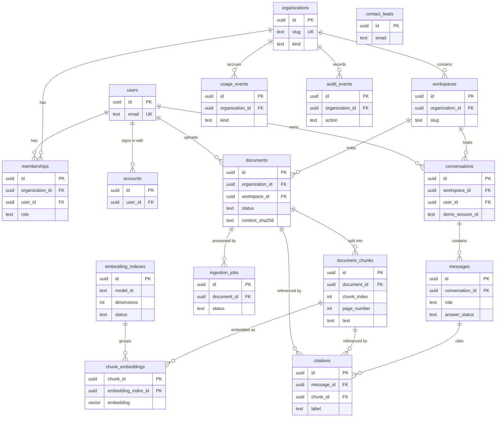

# Database schema

Status: **design**. No migration described here has been written or run. PostgreSQL 16 with the `vector` extension (pgvector), accessed through Drizzle ORM. pgvector facts were checked on 2026-11-15 against https://github.com/pgvector/pgvector (version 0.8.7) and Drizzle's guide at https://orm.drizzle.team/docs/guides/vector-similarity-search .

Related documents: `ARCHITECTURE.md`, `RAG_PIPELINE.md`, `SECURITY.md`.

## 1. Conventions

| Topic | Rule |
|---|---|
| Naming | `snake_case`, plural table names |
| Primary keys | `id uuid`, generated by the application as UUIDv7 (time-ordered, index-friendly); `DEFAULT gen_random_uuid()` as a fallback for manual inserts. PostgreSQL 16 has no built-in UUIDv7 function. |
| Timestamps | `timestamptz`, UTC. `created_at NOT NULL DEFAULT now()` everywhere; `updated_at` on mutable tables, maintained by the repository layer |
| Enumerations | `text` with a `CHECK` constraint (simpler to migrate than native enums) |
| Tenant scoping | Every tenant-owned table has `organization_id uuid NOT NULL` with a foreign key to `organizations`. Tables below the workspace level also carry `workspace_id`. Child tables repeat these columns (denormalized) so that every query and every row-level security policy can filter without a join. |
| Tenant consistency | Composite foreign keys such as `(document_id, organization_id) → documents (id, organization_id)` make it impossible for a child row to point at a parent in another organization. Parents expose `UNIQUE (id, organization_id)` for this purpose. |
| Deletion | Hard delete for document content (section 6). `ON DELETE` behaviour is stated per foreign key. |
| Extensions | `vector` (required). `pg_trgm` (optional, filename search and hybrid retrieval). Drizzle does not create extensions automatically; a custom SQL migration contains `CREATE EXTENSION IF NOT EXISTS vector;`. |
| Database roles | `hks_owner` owns objects and runs migrations and seed. `hks_app` is used by web and worker: no `BYPASSRLS`, no DDL. See section 7. |

## 2. Entity relationship diagram



## 3. Entities

Column lists show type, nullability and purpose. "Tenant" states how the table is scoped.

### 3.1 `organizations`

Tenant: this is the tenant root.

| Column | Type | Notes |
|---|---|---|
| `id` | `uuid` PK | |
| `name` | `text NOT NULL` | 1–120 characters |
| `slug` | `text NOT NULL UNIQUE` | Lowercase, URL-safe |
| `kind` | `text NOT NULL DEFAULT 'standard'` | `CHECK (kind IN ('standard','demo'))`. See section 8. |
| `created_at`, `updated_at` | `timestamptz NOT NULL` | |

Indexes: unique on `slug`; partial unique `ON (kind) WHERE kind = 'demo'` so that at most one demo organization exists.

### 3.2 `users`

Tenant: global identity; access to tenants is through `memberships`. Column names follow what the Auth.js Drizzle adapter expects; the exact names must be matched to the adapter version at implementation time.

| Column | Type | Notes |
|---|---|---|
| `id` | `uuid` PK | |
| `email` | `text NOT NULL` | Stored lowercased; unique index on `lower(email)` |
| `email_verified` | `timestamptz NULL` | Auth.js field |
| `name` | `text NULL` | |
| `image` | `text NULL` | Auth.js field; unused in the first delivery |
| `password_hash` | `text NULL` | Argon2id encoded hash; null for OAuth-only users |
| `locale` | `text NOT NULL DEFAULT 'en'` | `CHECK (locale IN ('he','en'))` |
| `disabled_at` | `timestamptz NULL` | Blocks sign-in when set |
| `created_at`, `updated_at` | `timestamptz NOT NULL` | |

### 3.3 `accounts` (Auth.js)

OAuth account links, required by the Auth.js adapter when an OAuth provider is enabled. Columns per the adapter: `user_id uuid NOT NULL → users(id) ON DELETE CASCADE`, `type`, `provider`, `provider_account_id`, token fields. Primary key `(provider, provider_account_id)`. Token columns hold provider secrets and are never selected by application queries outside the adapter.

Auth.js `sessions` and `verification_tokens` tables are not created in the first delivery, because the design uses the JWT session strategy (see `ARCHITECTURE.md` section 12). They are added by migration if database sessions or email verification are introduced.

### 3.4 `memberships`

Tenant: `organization_id`.

| Column | Type | Notes |
|---|---|---|
| `id` | `uuid` PK | |
| `organization_id` | `uuid NOT NULL → organizations(id) ON DELETE CASCADE` | |
| `user_id` | `uuid NOT NULL → users(id) ON DELETE CASCADE` | |
| `role` | `text NOT NULL` | `CHECK (role IN ('owner','admin','member'))` |
| `created_at` | `timestamptz NOT NULL` | |

Indexes: `UNIQUE (organization_id, user_id)`; index on `(user_id)`.

### 3.5 `workspaces`

Tenant: `organization_id`. The first delivery creates one default workspace per organization; the table exists so that collections or multiple workspaces (P1) need no schema change to tenant scoping.

| Column | Type | Notes |
|---|---|---|
| `id` | `uuid` PK | |
| `organization_id` | `uuid NOT NULL → organizations(id) ON DELETE CASCADE` | |
| `name` | `text NOT NULL` | |
| `slug` | `text NOT NULL` | |
| `created_at`, `updated_at` | `timestamptz NOT NULL` | |

Indexes: `UNIQUE (organization_id, slug)`; `UNIQUE (id, organization_id)` (composite foreign key target).

### 3.6 `documents`

Tenant: `organization_id`, `workspace_id`.

| Column | Type | Notes |
|---|---|---|
| `id` | `uuid` PK | |
| `organization_id` | `uuid NOT NULL` | Composite FK `(workspace_id, organization_id) → workspaces (id, organization_id)` |
| `workspace_id` | `uuid NOT NULL` | |
| `uploaded_by_user_id` | `uuid NULL → users(id) ON DELETE SET NULL` | Null for seeded demo documents |
| `title` | `text NOT NULL` | Display title; defaults to the filename without extension |
| `original_filename` | `text NOT NULL` | As supplied, length-limited (255), used for display only |
| `file_type` | `text NOT NULL` | `CHECK (file_type IN ('pdf','docx','txt','md'))`, set from server-side detection |
| `mime_type` | `text NOT NULL` | Server-validated value |
| `size_bytes` | `bigint NOT NULL` | `CHECK (size_bytes > 0)` |
| `content_sha256` | `text NULL` | Hex; computed by the worker from the stored bytes |
| `storage_key` | `text NOT NULL` | Server-generated object key |
| `language` | `text NULL` | Detected dominant language: `he`, `en`, `mixed`, or null |
| `page_count` | `integer NULL` | PDF only |
| `chunk_count` | `integer NOT NULL DEFAULT 0` | |
| `status` | `text NOT NULL` | See status values below |
| `failure_code` | `text NULL` | Stable code such as `unsupported_scanned_pdf`, `malformed_file`, `duplicate_document`, `extraction_failed`, `embedding_failed`, `too_many_pages` |
| `failure_detail` | `text NULL` | Safe, short, no document text |
| `ready_at` | `timestamptz NULL` | Set when status becomes `ready` |
| `created_at`, `updated_at` | `timestamptz NOT NULL` | |

Status values: `pending_upload`, `uploaded`, `queued`, `processing`, `ready`, `failed`, `unsupported`, `deleting`. Fine-grained progress (`extracting`, `chunking`, `embedding`) lives on `ingestion_jobs.step`. Only `ready` documents have rows in `chunk_embeddings` for the active index, so retrieval needs no status filter.

Indexes:

- `UNIQUE (id, organization_id)`.
- `(organization_id, workspace_id, created_at DESC)` — library listing.
- `(organization_id, workspace_id, status)` — status filter.
- Partial unique `(workspace_id, content_sha256) WHERE content_sha256 IS NOT NULL AND status IN ('processing','ready')` — duplicate protection. A second upload of identical bytes fails ingestion with `duplicate_document`.
- Optional GIN `(lower(title || ' ' || original_filename) gin_trgm_ops)` for substring search when `pg_trgm` is available; otherwise `ILIKE` on the tenant-filtered set, which is acceptable at the expected library sizes.

**Document versions.** Not modelled in the first delivery. Replacing a document means deleting it and uploading a new one. A `document_versions` table is added only if in-place replacement becomes a requirement; `storage_key` deliberately contains no version segment that would have to be migrated.

### 3.7 `document_chunks`

Tenant: `organization_id`, `workspace_id` (denormalized).

| Column | Type | Notes |
|---|---|---|
| `id` | `uuid` PK | Stable chunk ID; citation target |
| `organization_id` | `uuid NOT NULL` | Composite FK `(document_id, organization_id) → documents (id, organization_id) ON DELETE CASCADE` |
| `workspace_id` | `uuid NOT NULL` | |
| `document_id` | `uuid NOT NULL` | |
| `chunk_index` | `integer NOT NULL` | 0-based order within the document |
| `page_number` | `integer NULL` | 1-based first page of the chunk; PDF only; from extraction, never inferred |
| `page_end` | `integer NULL` | Last page when a chunk spans a page boundary |
| `section_path` | `text[] NULL` | Heading trail, for example `{"Refunds","Eligibility"}` |
| `text` | `text NOT NULL` | Evidence text shown to users (normalized for display) |
| `search_text` | `text NOT NULL` | Text normalized for lexical search (see `RAG_PIPELINE.md` section 4) |
| `fts` | `tsvector GENERATED ALWAYS AS (to_tsvector('simple', search_text)) STORED` | Optional hybrid retrieval |
| `char_count` | `integer NOT NULL` | |
| `token_estimate` | `integer NOT NULL` | Heuristic, used for context budgeting |
| `chunking_version` | `text NOT NULL` | Identifies chunker algorithm and parameters, for example `v1:1200/1800/200` |
| `created_at` | `timestamptz NOT NULL` | |

Indexes: `UNIQUE (document_id, chunk_index)`; `UNIQUE (id, organization_id)`; `(organization_id, workspace_id)`; GIN on `fts` (created only when hybrid retrieval is enabled).

### 3.8 `embedding_indexes`

Tenant: global registry (no tenant data).

| Column | Type | Notes |
|---|---|---|
| `id` | `uuid` PK | |
| `provider` | `text NOT NULL` | `bedrock-cohere`, `deterministic`, … |
| `model_id` | `text NOT NULL` | For example `cohere.embed-multilingual-v3`, copied from configuration when the index is created |
| `kind` | `text NOT NULL` | `CHECK (kind IN ('live','test_double'))` |
| `dimensions` | `integer NOT NULL` | 1024 for the configured model |
| `distance` | `text NOT NULL DEFAULT 'cosine'` | |
| `storage_table` | `text NOT NULL DEFAULT 'chunk_embeddings'` | Physical table holding vectors of this dimension |
| `status` | `text NOT NULL` | `CHECK (status IN ('building','active','retired'))` |
| `created_at`, `activated_at`, `retired_at` | `timestamptz` | |

Indexes: `UNIQUE (id, dimensions)` (composite foreign key target); partial unique `ON (kind) WHERE status = 'active'` — at most one active index per kind, so a deployment has exactly one live retrieval index at a time.

### 3.9 `chunk_embeddings`

Tenant: `organization_id`, `workspace_id` (denormalized so that the vector query filters without a join).

| Column | Type | Notes |
|---|---|---|
| `chunk_id` | `uuid NOT NULL` | Composite FK `(chunk_id, organization_id) → document_chunks (id, organization_id) ON DELETE CASCADE` |
| `embedding_index_id` | `uuid NOT NULL` | Composite FK `(embedding_index_id, dimensions) → embedding_indexes (id, dimensions)` |
| `dimensions` | `integer NOT NULL DEFAULT 1024` | `CHECK (dimensions = 1024)` |
| `organization_id` | `uuid NOT NULL` | |
| `workspace_id` | `uuid NOT NULL` | |
| `document_id` | `uuid NOT NULL` | Enables per-document filters and deletes |
| `embedding` | `vector(1024) NOT NULL` | |
| `created_at` | `timestamptz NOT NULL` | |

Primary key `(chunk_id, embedding_index_id)`.

Every chunk's embedding therefore records its model through `embedding_index_id` → `embedding_indexes.model_id`. The API returns the model ID with chunk metadata, which satisfies the requirement that each chunk records its embedding model identifier.

Indexes:

```sql
-- Approximate nearest neighbour, cosine distance (pgvector defaults: m = 16, ef_construction = 64)
CREATE INDEX chunk_embeddings_hnsw_cosine
  ON chunk_embeddings USING hnsw (embedding vector_cosine_ops);

-- Tenant filter / exact-scan path
CREATE INDEX chunk_embeddings_tenant
  ON chunk_embeddings (organization_id, workspace_id, embedding_index_id);

CREATE INDEX chunk_embeddings_document ON chunk_embeddings (document_id);
```

Drizzle sketch: `vector('embedding', { dimensions: 1024 })` and `index(...).using('hnsw', t.embedding.op('vector_cosine_ops'))`.

Query shape (cosine distance operator `<=>`; similarity = `1 - distance`):

```sql
SET LOCAL hnsw.iterative_scan = strict_order;   -- pgvector >= 0.8
SELECT e.chunk_id, 1 - (e.embedding <=> $1) AS similarity
FROM chunk_embeddings e
WHERE e.organization_id = $2
  AND e.workspace_id = $3
  AND e.embedding_index_id = $4
ORDER BY e.embedding <=> $1
LIMIT $5;
```

Filtering note: pgvector applies `WHERE` filters after the approximate index scan, so a selective tenant filter can return fewer than `LIMIT` rows. Two mitigations are part of the design: iterative index scans (`hnsw.iterative_scan`), and the planner's ability to choose the b-tree tenant index plus an exact sort when a tenant has few rows — which is the normal case at this product's scale and gives exact results. If one tenant grows large enough for this to matter, pgvector's documented options are partial indexes or partitioning by tenant. Which plan the planner picks, and recall under filtering, must be measured with `EXPLAIN ANALYZE` on realistic data; it is not verified.

### 3.10 `ingestion_jobs`

Tenant: `organization_id`.

| Column | Type | Notes |
|---|---|---|
| `id` | `uuid` PK | |
| `organization_id` | `uuid NOT NULL` | Composite FK `(document_id, organization_id) → documents ON DELETE CASCADE` |
| `document_id` | `uuid NOT NULL` | |
| `kind` | `text NOT NULL` | `ingest`, `reindex` |
| `status` | `text NOT NULL` | `queued`, `running`, `succeeded`, `failed`, `cancelled` |
| `step` | `text NULL` | `validating`, `extracting`, `normalizing`, `chunking`, `embedding`, `persisting` |
| `progress` | `smallint NOT NULL DEFAULT 0` | 0–100, coarse |
| `attempt` | `integer NOT NULL DEFAULT 0` | |
| `error_code` | `text NULL` | Stable code |
| `error_detail` | `text NULL` | Safe, short |
| `embedding_index_id` | `uuid NULL → embedding_indexes(id)` | Target index |
| `correlation_id` | `text NOT NULL` | From the request that started it |
| `queued_at`, `started_at`, `finished_at` | `timestamptz` | |

Indexes: `(document_id, queued_at DESC)`; `(status) WHERE status IN ('queued','running')`.

### 3.11 `conversations`

Tenant: `organization_id`, `workspace_id`. Ownership: exactly one of `user_id` or `demo_session_id`.

| Column | Type | Notes |
|---|---|---|
| `id` | `uuid` PK | |
| `organization_id`, `workspace_id` | `uuid NOT NULL` | Composite FK to `workspaces` |
| `user_id` | `uuid NULL → users(id) ON DELETE CASCADE` | Owner for authenticated use |
| `demo_session_id` | `text NULL` | Owner for the anonymous demo; random ID from the signed cookie |
| `title` | `text NULL` | Derived from the first question, truncated; no model call |
| `locale` | `text NOT NULL` | UI locale at creation |
| `last_message_at` | `timestamptz NULL` | |
| `created_at`, `updated_at` | `timestamptz NOT NULL` | |

Constraints: `CHECK ((user_id IS NULL) <> (demo_session_id IS NULL))`.
Indexes: `UNIQUE (id, organization_id)`; `(organization_id, workspace_id, user_id, last_message_at DESC)`; `(demo_session_id) WHERE demo_session_id IS NOT NULL`; `(created_at) WHERE demo_session_id IS NOT NULL` for the purge job.

Conversations are private to their owner. Membership in the organization does not grant access to another member's conversations.

### 3.12 `messages`

Tenant: `organization_id`.

| Column | Type | Notes |
|---|---|---|
| `id` | `uuid` PK | |
| `organization_id` | `uuid NOT NULL` | Composite FK `(conversation_id, organization_id) → conversations ON DELETE CASCADE` |
| `conversation_id` | `uuid NOT NULL` | |
| `role` | `text NOT NULL` | `CHECK (role IN ('user','assistant'))` |
| `content` | `text NOT NULL` | Markdown; for assistant messages, after citation filtering |
| `status` | `text NOT NULL` | `complete`, `streaming`, `cancelled`, `failed` |
| `answer_status` | `text NULL` | Assistant only: `answered`, `insufficient_evidence`, `uncited` |
| `pipeline_mode` | `text NULL` | Assistant only: `live` or `sample` |
| `llm_provider`, `llm_model_id` | `text NULL` | Assistant only; copied from the provider descriptor |
| `embedding_index_id` | `uuid NULL → embedding_indexes(id)` | Index used for retrieval |
| `input_tokens`, `output_tokens` | `integer NULL` | |
| `retrieval` | `jsonb NULL` | Compact retrieval trace: chunk IDs, labels, scores, threshold values. No text. |
| `error_code` | `text NULL` | |
| `correlation_id` | `text NOT NULL` | |
| `created_at` | `timestamptz NOT NULL` | |

Indexes: `(conversation_id, created_at)`; `UNIQUE (id, organization_id)`.

### 3.13 `citations`

Tenant: `organization_id`. One row per distinct source cited by an assistant message. Rows are written only after server-side validation against the retrieved set.

| Column | Type | Notes |
|---|---|---|
| `id` | `uuid` PK | |
| `organization_id` | `uuid NOT NULL` | Composite FK `(message_id, organization_id) → messages ON DELETE CASCADE` |
| `message_id` | `uuid NOT NULL` | |
| `label` | `text NOT NULL` | Marker used in the answer text, for example `S2` |
| `ordinal` | `integer NOT NULL` | Display order (first appearance) |
| `chunk_id` | `uuid NULL → document_chunks(id) ON DELETE SET NULL` | Citation-to-chunk relationship |
| `document_id` | `uuid NULL → documents(id) ON DELETE SET NULL` | |
| `document_title` | `text NULL` | Snapshot for display |
| `page_number` | `integer NULL` | Snapshot from the chunk |
| `section_path` | `text[] NULL` | Snapshot from the chunk |
| `excerpt` | `text NULL` | Snapshot of the evidence passage (bounded length) |
| `similarity` | `real NULL` | Retrieval score |
| `source_state` | `text NOT NULL DEFAULT 'available'` | `available`, `removed` |
| `created_at` | `timestamptz NOT NULL` | |

Indexes: `UNIQUE (message_id, label)`; `(chunk_id)`; `(document_id)`.

The snapshot columns keep a reopened conversation readable without a join and independent of later re-chunking. They are cleared when the source document is deleted (section 6).

### 3.14 `usage_events`

Tenant: `organization_id`. Append-only.

| Column | Type | Notes |
|---|---|---|
| `id` | `uuid` PK | |
| `organization_id` | `uuid NOT NULL → organizations(id) ON DELETE CASCADE` | |
| `workspace_id` | `uuid NULL` | |
| `user_id` | `uuid NULL` | |
| `demo_session_id` | `text NULL` | |
| `kind` | `text NOT NULL` | `chat_completion`, `query_embedding`, `document_embedding` |
| `provider`, `model_id` | `text NOT NULL` | |
| `provider_kind` | `text NOT NULL` | `live` or `test_double`; doubles are excluded from spend reports |
| `input_tokens`, `output_tokens` | `integer NOT NULL DEFAULT 0` | |
| `units` | `integer NOT NULL DEFAULT 0` | Texts embedded, for embedding events |
| `message_id`, `document_id` | `uuid NULL` | Plain references, no foreign key, so events survive deletions |
| `correlation_id` | `text NOT NULL` | |
| `created_at` | `timestamptz NOT NULL` | |

Indexes: `(organization_id, created_at DESC)`; `(created_at)` for global spend review. No monetary amount is stored; cost is derived at report time from a price table in configuration, because prices change.

### 3.15 `contact_leads`

Tenant: none (marketing data, not tenant data). Accessible only to the insert path of the contact endpoint and to operators.

| Column | Type | Notes |
|---|---|---|
| `id` | `uuid` PK | |
| `name` | `text NOT NULL` | ≤ 120 |
| `email` | `text NOT NULL` | Validated |
| `company` | `text NULL` | ≤ 160 |
| `message` | `text NULL` | ≤ 2,000 |
| `locale` | `text NOT NULL` | |
| `source` | `text NOT NULL DEFAULT 'landing'` | |
| `consent_at` | `timestamptz NULL` | When a consent checkbox is used |
| `ip_hash` | `text NULL` | Salted hash for abuse analysis; no raw IP |
| `status` | `text NOT NULL DEFAULT 'new'` | `new`, `handled`, `spam` |
| `created_at` | `timestamptz NOT NULL` | |

Index: `(created_at DESC)`.

### 3.16 `audit_events`

Tenant: `organization_id` (nullable for events before a tenant is known, such as failed sign-in). Append-only: `hks_app` has `INSERT` and tenant-scoped `SELECT` only.

| Column | Type | Notes |
|---|---|---|
| `id` | `uuid` PK | |
| `organization_id` | `uuid NULL` | No cascade: audit rows outlive the entities they describe |
| `actor_user_id` | `uuid NULL` | |
| `actor_kind` | `text NOT NULL` | `user`, `demo`, `system`, `anonymous` |
| `action` | `text NOT NULL` | For example `auth.sign_in`, `auth.sign_in_failed`, `document.upload_initiated`, `document.deleted`, `document.download_url_issued`, `access.denied`, `membership.changed`, `limit.exceeded` |
| `target_type`, `target_id` | `text NULL`, `uuid NULL` | |
| `outcome` | `text NOT NULL` | `success`, `denied`, `failure` |
| `metadata` | `jsonb NOT NULL DEFAULT '{}'` | IDs and codes only; no document text, no filenames, no secrets |
| `ip_hash` | `text NULL` | |
| `correlation_id` | `text NOT NULL` | |
| `created_at` | `timestamptz NOT NULL` | |

Indexes: `(organization_id, created_at DESC)`; `(action, created_at DESC)`.

## 4. Vector dimension and model compatibility

1. The physical column is `vector(1024)`. PostgreSQL rejects a vector of any other length at insert time.
2. `chunk_embeddings.dimensions` is constrained to 1024, and the composite foreign key `(embedding_index_id, dimensions)` means a `chunk_embeddings` row can only reference an `embedding_indexes` row whose `dimensions` is also 1024. An index registered with another dimension cannot own rows in this table.
3. At start, web and worker compare `EMBEDDINGS_MODEL_ID` and `EMBEDDINGS_DIMENSIONS` with the active `embedding_indexes` row of the matching kind. On mismatch the process refuses to serve retrieval or ingestion and logs the required operator action. It never writes vectors from one model under another model's index.
4. Every retrieval query filters on one `embedding_index_id`. Vectors produced by different models are never compared, even when their dimensions happen to match — for example the 1024-dimension `Deterministic` test double and the 1024-dimension Cohere model.

## 5. Reindexing strategy

Reindexing is an explicit, operator-started procedure. It is not triggered by changing an environment variable.

**Same dimension (for example a new 1024-dimension model, or re-chunking).**

1. Insert an `embedding_indexes` row with `status = 'building'`.
2. Enqueue `reindex-document` for every `ready` document. Each job reads chunk text, calls the new provider and inserts `chunk_embeddings` rows under the building index. Chunk IDs do not change, so existing citations stay valid.
3. Retrieval keeps using the old active index throughout.
4. When every document has succeeded and the evaluation run on the building index is accepted, one transaction sets the old index to `retired` and the new one to `active`. Configuration is switched in the same release.
5. A maintenance job deletes the retired index's rows in batches.

While two indexes coexist, one HNSW graph contains both sets of vectors and the query filter selects one. If recall suffers during that window, the reindex migration creates a partial HNSW index `WHERE embedding_index_id = '<new id>'` for the new index.

If chunking parameters also change, new `document_chunks` rows are produced per document and the old ones are removed at cut-over. Citations that pointed at removed chunks keep their snapshot and have `chunk_id` set to null.

**Different dimension.**

A migration creates a new physical table (for example `chunk_embeddings_1536`) with its own `vector(n)` column, check constraint and HNSW index, and the new `embedding_indexes` row names it in `storage_table`. The repository selects the table from the active index row. Steps 2–5 above then apply, and the old table is dropped after retirement. pgvector indexes the `vector` type up to 2,000 dimensions; larger models would need `halfvec` or dimension reduction, which is outside this design.

## 6. Deletion semantics

Policy: **immediate hard delete of document content, tombstoned citations.** This defines the behaviour referenced by LIB-12 and CIT-10.

Order of operations for `DELETE /api/v1/documents/{id}`:

1. **Request (web, one transaction).** Authorize; set `documents.status = 'deleting'`; delete all `chunk_embeddings` rows for the document; write an `audit_events` row; enqueue `delete-document`; respond `202`. From the commit of this transaction the document cannot be retrieved, because retrieval reads `chunk_embeddings`.
2. **Citations (worker, one transaction).** For citations referencing the document: set `source_state = 'removed'`, clear `excerpt`, `section_path` and `page_number`. `document_title` is kept so the UI can say which source was removed.
3. **Chunks and document row (same transaction).** Delete the `documents` row. Cascades remove `document_chunks`, any remaining `chunk_embeddings`, and `ingestion_jobs`. `citations.chunk_id` and `citations.document_id` become null through `ON DELETE SET NULL`.
4. **Object storage.** Delete the object at `storage_key`. This runs after the database commit. If it fails, the job retries; the job payload carries the storage key because the row no longer exists. A periodic sweep lists objects under `org/` whose document ID has no row and removes them, so a lost job cannot leave an orphan indefinitely.
5. **Audit.** Write `document.deleted` with outcome and the correlation ID.

What remains after deletion, stated honestly:

- Assistant messages that were generated from the document remain in conversations. They may paraphrase or quote its content. Deleting a document does not rewrite past answers. The UI shows the citation as "source removed".
- `usage_events` and `audit_events` keep the document's ID (not its name or content).
- Database backups and object-store versioning, if enabled in a deployment, retain data for their own retention period. `DEPLOYMENT.md` records those settings.

Other deletions:

| Action | Effect |
|---|---|
| Delete conversation | Cascades to messages and citations |
| Delete user | Cascades to memberships, accounts and the user's conversations; `documents.uploaded_by_user_id` becomes null |
| Delete organization | Cascades to all tenant tables; a job removes the `org/{id}/` object prefix; audit rows remain with the organization ID |
| Demo conversation retention | Purged by job after `DEMO_CONVERSATION_TTL_HOURS` |

## 7. Tenant isolation in the database

Primary control: every repository function takes a tenant context and adds `organization_id = $ctx` (and `workspace_id` where relevant) to every statement. There is no repository function that queries a tenant table without one.

Defence in depth: row-level security.

- RLS is enabled on every tenant table. It is not `FORCE`d: the owner role (`hks_owner`, used only for migrations and seed) bypasses policies, while `hks_app`, which owns nothing and has no `BYPASSRLS`, is always subject to them.
- The repository layer opens each unit of work in a transaction and runs `SELECT set_config('app.organization_id', $1, true)` (transaction-local) before any statement.
- Policy template:

```sql
CREATE POLICY tenant_isolation ON documents
  USING (organization_id = current_setting('app.organization_id', true)::uuid)
  WITH CHECK (organization_id = current_setting('app.organization_id', true)::uuid);
```

- When the setting is absent, `current_setting(..., true)` returns null and the predicate is not true, so no rows are visible and no rows can be written. Missing context fails closed.
- Transaction-local settings are safe with connection pooling in transaction mode; session-level `SET` is not used.
- A small number of operations are legitimately cross-tenant (sign-in lookup by email, listing a user's memberships, maintenance sweeps, contact leads). They run through narrowly scoped repository functions on tables without tenant policies (`users`, `memberships` by `user_id`) or through `SECURITY DEFINER` functions owned by `hks_owner`, each reviewed individually.

RLS is not a substitute for the application-level filter; it exists so that a forgotten filter returns nothing instead of another tenant's data. The policies are part of the integration test suite and need a real PostgreSQL to test.

## 8. The public demo organization

- One `organizations` row with `kind = 'demo'` and a fixed slug, one workspace, and the Northstar Business Services sample documents. Created only by the seed script, which runs as `hks_owner` through the same ingestion code path as uploads (so demo chunks and embeddings are real pipeline output, not hand-written rows).
- No `memberships` rows. Nobody signs in to the demo organization. Anonymous visitors reach it through the demo session described in `ARCHITECTURE.md` section 12.
- Read-only for the application role. Policies on `documents`, `document_chunks`, `chunk_embeddings` and `ingestion_jobs` add `AND NOT is_demo_organization(organization_id)` to `WITH CHECK` and to the `UPDATE`/`DELETE` policies, where `is_demo_organization` is a stable SQL function. `hks_app` therefore cannot add, change or remove demo documents even if an application check is missed. The API additionally returns `403 demo_read_only` for document writes in a demo context.
- Writable in the demo organization: `conversations`, `messages`, `citations`, `usage_events`, `audit_events` — scoped by `demo_session_id`, rate limited, and purged after the retention window.
- Isolation from private tenants is the ordinary tenant isolation: the demo context carries the demo `organization_id`, every query filters on it, and RLS enforces it. Demo objects live under the demo organization's own key prefix.
- Demo embeddings follow the same index rules. If the deployment runs in sample mode, demo vectors sit under the `test_double` index and every answer is labelled as a sample.

## 9. Migrations and seed

- SQL migrations are generated with drizzle-kit and committed. Extension creation, RLS policies, helper functions, role grants and the HNSW index are hand-written custom migrations, because drizzle-kit does not generate all of them.
- Migrations run as `hks_owner` using `DATABASE_MIGRATION_URL`; the application never runs DDL.
- Seed is idempotent: it upserts the demo organization and workspace, registers the active embedding index for the configured provider, uploads the sample files to object storage and ingests them. Commands are in `DEPLOYMENT.md`.
