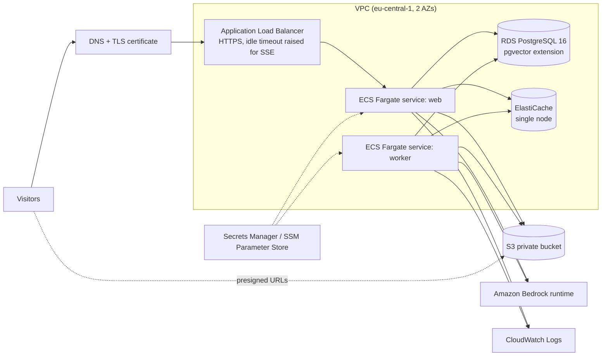

# Deployment

Status: **design**. Nothing described here is deployed. No AWS resource has been created, and none will be created without the owner's explicit approval. File names such as `infrastructure/docker-compose.yml` and `.env.example` describe what is to be written; this document does not assert that they exist or work. Commands are the intended interface, not a record of commands that were run, except in section 2.

Related documents: `ARCHITECTURE.md`, `DATABASE_SCHEMA.md`, `SECURITY.md`.

## 1. Environments

| | development | demo | production |
|---|---|---|---|
| Purpose | Local work on a developer machine | Public portfolio deployment with the fictional sample documents | Real tenants |
| `APP_ENV` | `development` | `demo` | `production` |
| PostgreSQL, Redis, storage | Docker Compose (pgvector image, Redis, MinIO) | Managed or single-host (section 7) | Managed services |
| Chat model | Anthropic API | Amazon Bedrock, once approved and configured | Amazon Bedrock |
| Embeddings | Amazon Bedrock Cohere Embed when credentials and network allow; otherwise sample mode | Amazon Bedrock Cohere Embed | Amazon Bedrock Cohere Embed |
| Test doubles | Allowed with `SAMPLE_MODE=true`, always labelled | Allowed with `SAMPLE_MODE=true`, always labelled | Refused at start |
| Sign-up | Open | Closed by default | Configurable |
| Secrets | `.env` (git-ignored) | Secret manager | Secret manager |
| Limits | Relaxed | Strict demo limits and global budget | Per-organization budgets |

Each environment has its own database, Redis, bucket, `AUTH_SECRET` and credentials. Nothing is shared between them. The application is independent of the existing HilaTech SaaS platform: separate repository, separate data stores, separate credentials.

## 2. Build sandbox findings (read-only checks, 2026-11-15)

These are observations of the sandbox in which this design was written. Nothing was installed.

| Check | Result |
|---|---|
| `psql --version` | PostgreSQL 16.15 (Ubuntu 16.15-0ubuntu0.24.04.1); `pg_config` present |
| `pg_lsclusters` | Cluster `16/main` exists on port 5432, status `down` |
| `ls /usr/share/postgresql/16/extension \| grep -i vector` | No match: `vector.control` is absent |
| `ls /usr/lib/postgresql/16/lib \| grep -i vector` | No match: no `vector.so` |
| `apt-cache policy postgresql-16-pgvector` | No output. `/var/lib/apt/lists` is empty, so apt has no package index; whether the package could be installed is unknown without `apt update`, which was not run |
| `/usr/include/postgresql/16/server` | Absent: server development headers are not installed, so pgvector cannot be compiled from source without adding a system package |
| `docker --version` / `docker ps` | Client 29.9.3 is installed; the daemon is not running (no `/var/run/docker.sock`) |
| `node --version`, `pnpm --version` | v22.23.4, 10.28.0 |
| Model providers | Per the lead's environment notes: `api.anthropic.com` is reachable; Amazon Bedrock is not |

Conclusions:

1. **pgvector is not available in the local PostgreSQL 16 installation.** Using it there would require installing `postgresql-16-pgvector` (the package name follows the pgvector README's `postgresql-NN-pgvector` pattern, https://github.com/pgvector/pgvector) or building from source; both are system changes that need approval.
2. **Docker Compose cannot run in the sandbox** as it stands, because there is no Docker daemon.
3. **Fallback for database tests in the sandbox: PGlite.** Note a correction to the starting assumption: pgvector is *not* bundled in the main PGlite package. It is a separate package, `@electric-sql/pglite-pgvector` (https://pglite.dev/extensions/; npm version 0.0.17, with `@electric-sql/pglite` at 0.5.16). Whether that build supports HNSW indexes and `hnsw.iterative_scan` is not stated on the extensions page and is unverified. PGlite is single-user and cannot exercise database roles, so row-level security tests cannot run on it.
4. **Live RAG cannot be verified in the sandbox.** The chosen embeddings model is available only through Amazon Bedrock, which is unreachable there. The chat model could be called through the Anthropic API if a key is provided, but without real embeddings the pipeline runs in sample mode and must be labelled as such.

## 3. Local development with Docker Compose

Target file: `infrastructure/docker-compose.yml`. Intended services:

| Service | Image (pin an exact tag or digest) | Ports | Notes |
|---|---|---|---|
| `postgres` | `pgvector/pgvector:pg16` (the pgvector README lists `pg16` tags) | 5432 | Named volume. Init script creates roles `hks_owner` and `hks_app` and the database. Health check with `pg_isready`. |
| `redis` | Official Redis image, current stable major | 6379 | Started with `--maxmemory-policy noeviction --appendonly yes`, as BullMQ requires (https://docs.bullmq.io/guide/going-to-production). |
| `minio` | MinIO server image | 9000 (API), 9001 (console) | Named volume. Root credentials from `.env`. |
| `minio-init` | MinIO client image | — | One-shot: creates the private bucket and sets CORS for `http://localhost:3000`. |

Sketch (illustrative, not final):

```yaml
services:
  postgres:
    image: pgvector/pgvector:pg16
    environment:
      POSTGRES_USER: hks_owner
      POSTGRES_PASSWORD: ${POSTGRES_OWNER_PASSWORD}
      POSTGRES_DB: hks
    ports: ["5432:5432"]
    volumes:
      - pgdata:/var/lib/postgresql/data
      - ./postgres/init:/docker-entrypoint-initdb.d:ro
    healthcheck:
      test: ["CMD-SHELL", "pg_isready -U hks_owner -d hks"]
  redis:
    image: redis:<pinned-tag>
    command: ["redis-server", "--maxmemory-policy", "noeviction", "--appendonly", "yes"]
    ports: ["6379:6379"]
  minio:
    image: <minio-server-image>:<pinned-tag>
    command: ["server", "/data", "--console-address", ":9001"]
    environment:
      MINIO_ROOT_USER: ${S3_ACCESS_KEY_ID}
      MINIO_ROOT_PASSWORD: ${S3_SECRET_ACCESS_KEY}
    ports: ["9000:9000", "9001:9001"]
    volumes: ["miniodata:/data"]
volumes: { pgdata: {}, miniodata: {} }
```

Notes:

- The web app and worker run on the host with `pnpm` during development, not in containers, for fast reload. Dockerfiles for both exist for deployed environments (section 7).
- All Compose ports bind to `127.0.0.1` only.
- MinIO image availability and its support for presigned POST policies with `content-length-range` have not been checked. If the official image is unsuitable, any S3-compatible server that supports presigned POST can take its place; only `S3_ENDPOINT` changes.
- Presigned URLs are opened by the browser, so `S3_PUBLIC_ENDPOINT` must be an address the browser can reach (`http://localhost:9000` locally).

### 3.1 First run (intended commands)

```bash
cp .env.example .env            # then fill in local values; never commit .env
pnpm install
docker compose -f infrastructure/docker-compose.yml up -d
pnpm db:migrate                 # runs SQL migrations as hks_owner (DATABASE_MIGRATION_URL)
pnpm db:seed                    # demo organization + sample documents, through the ingestion code path
pnpm dev                        # web on http://localhost:3000
pnpm worker:dev                 # ingestion worker, in a second terminal
```

### 3.2 Migrations and seed

- `pnpm db:generate` — drizzle-kit generates SQL from the schema into `packages/database/migrations`. Hand-written custom migrations cover `CREATE EXTENSION IF NOT EXISTS vector`, roles and grants, row-level security policies, helper functions and the HNSW index (Drizzle does not create the extension itself: https://orm.drizzle.team/docs/guides/vector-similarity-search).
- `pnpm db:migrate` — applies pending migrations in order using `DATABASE_MIGRATION_URL` (owner role). The application role cannot run DDL. In deployed environments this runs as a one-off task before the new version starts; migrations are written to be backward compatible with the previous application version.
- `pnpm db:seed` — idempotent. Creates the demo organization and workspace, registers the active embedding index for the configured embeddings provider, uploads the Northstar Business Services sample files to object storage and ingests them. With a live embeddings provider this makes real embedding calls (a small, one-time cost); with `SAMPLE_MODE=true` it uses the `Deterministic` double and registers a `test_double` index.
- `pnpm db:seed --dev-user` — optionally creates a local test organization and user. Credentials are printed once to the terminal and are never the same across runs.
- `pnpm db:reset` — development only; refuses to run unless `APP_ENV=development`.

### 3.3 Worker startup

- Development: `pnpm worker:dev` (watch mode). Deployed: `node apps/worker/dist/index.js` in its own container.
- On start the worker validates configuration, checks the database connection and extension, compares the configured embeddings model with the active `embedding_indexes` row (refusing to process on mismatch), then connects to Redis and begins consuming `ingestion`, `maintenance` and `reindex` queues.
- Concurrency: `WORKER_CONCURRENCY`. Shutdown: `SIGTERM` stops taking new jobs and waits for running jobs up to a grace period; interrupted jobs are retried by BullMQ.
- The worker needs outbound access to PostgreSQL, Redis, object storage and the embeddings provider. It accepts no inbound traffic other than a liveness probe.
- Without a running worker, uploaded documents stay `queued`; the UI shows that state and never reports them as ready.

### 3.4 Running without Docker

For machines where Docker is unavailable (including the current sandbox):

- Database tests can use PGlite with `@electric-sql/pglite-pgvector` through a test-only database factory. Limits are listed in section 2.
- A system PostgreSQL 16 can be used if pgvector is installed into it; that is a system change and needs approval.
- Object storage and Redis have no in-process substitute in this design. Tests that need them are skipped and reported as skipped.

## 4. Environment variable reference

This table is the specification for `.env.example`, which must list the same names with placeholder values only. "Secret" variables come from a secret manager in deployed environments.

| Variable | Required | Example / default | Secret | Description |
|---|---|---|---|---|
| `APP_ENV` | yes | `development` | no | `development`, `demo`, `production`, `test` |
| `APP_BASE_URL` | yes | `http://localhost:3000` | no | Public origin; used for Origin checks and links |
| `DEFAULT_LOCALE` | no | `en` | no | `he` or `en` |
| `LOG_LEVEL` | no | `info` | no | pino level |
| `TRUSTED_PROXY_HOPS` | no | `0` | no | Number of trusted proxies in front of the app, for client IP resolution |
| `IP_HASH_SALT` | yes | — | yes | Salt for hashing client IPs |
| `DATABASE_URL` | yes | `postgres://hks_app:…@localhost:5432/hks` | yes | Application role connection |
| `DATABASE_MIGRATION_URL` | migrations only | `postgres://hks_owner:…@localhost:5432/hks` | yes | Owner role; not present in the web or worker runtime |
| `REDIS_URL` | yes | `redis://localhost:6379` | yes (when it contains a password) | Queues, rate limits, usage counters |
| `S3_BUCKET` | yes | `hks-documents-dev` | no | Private bucket |
| `S3_REGION` | yes | `eu-central-1` | no | |
| `S3_ENDPOINT` | local only | `http://localhost:9000` | no | Set for MinIO; unset for AWS |
| `S3_PUBLIC_ENDPOINT` | local only | `http://localhost:9000` | no | Endpoint used in presigned URLs |
| `S3_FORCE_PATH_STYLE` | local only | `true` | no | Required by MinIO |
| `S3_ACCESS_KEY_ID`, `S3_SECRET_ACCESS_KEY` | local only | — | yes | MinIO credentials. In AWS the task role is used and these are unset |
| `AUTH_SECRET` | yes | — | yes | ≥ 32 random bytes; unique per environment |
| `AUTH_URL` | deployed | `https://…` | no | Canonical URL for Auth.js |
| `AUTH_TRUST_HOST` | deployed behind a proxy | `true` | no | |
| `AUTH_SIGNUP_ENABLED` | no | `true` (development), `false` (demo) | no | |
| `AUTH_GITHUB_ID`, `AUTH_GITHUB_SECRET` | no | — | yes | Optional OAuth provider; enabled only when both are set |
| `LLM_PROVIDER` | yes | `anthropic` | no | `anthropic`, `bedrock`, `deterministic` |
| `LLM_MODEL_ID` | yes | `claude-haiku-5-5` (Anthropic API); `eu.anthropic.claude-haiku-5-5` or `global.anthropic.claude-haiku-5-5` (Bedrock) | no | The only place a chat model ID is set |
| `LLM_MAX_OUTPUT_TOKENS` | no | `1024` | no | |
| `LLM_EFFORT` | no | `low` | no | Reasoning effort passed by the Claude adapters; proposal, to be confirmed by evaluation |
| `LLM_TIMEOUT_MS` | no | `60000` | no | |
| `ANTHROPIC_API_KEY` | when `LLM_PROVIDER=anthropic` | — | yes | Development only |
| `AWS_REGION` | when a Bedrock provider or AWS S3 is used | `eu-central-1` | no | |
| `BEDROCK_REGION` | no | value of `AWS_REGION` | no | Region whose `bedrock-runtime` endpoint is called |
| AWS credentials | when Bedrock is used outside AWS | standard SDK chain (`AWS_PROFILE`, or `AWS_ACCESS_KEY_ID` / `AWS_SECRET_ACCESS_KEY` / `AWS_SESSION_TOKEN`) | yes | In AWS, the task role supplies credentials; no keys are configured |
| `EMBEDDINGS_PROVIDER` | yes | `bedrock-cohere` | no | `bedrock-cohere`, `deterministic` |
| `EMBEDDINGS_MODEL_ID` | yes | `cohere.embed-multilingual-v3` | no | The only place the embeddings model ID is set |
| `EMBEDDINGS_DIMENSIONS` | yes | `1024` | no | Must equal the active index and the column dimension |
| `EMBEDDINGS_BATCH_SIZE` | no | `64` | no | ≤ 96 for Cohere Embed v3 |
| `SAMPLE_MODE` | no | `false` | no | Permits `deterministic` providers in `development` and `demo`; forces the sample label |
| `RAG_TOP_K` | no | `12` | no | |
| `RAG_MIN_SIMILARITY` | no | `0.30` (placeholder) | no | To be calibrated |
| `RAG_EVIDENCE_MIN_SIMILARITY` | no | `0.40` (placeholder) | no | To be calibrated |
| `RAG_MAX_CONTEXT_CHUNKS` | no | `6` | no | |
| `RAG_MAX_CONTEXT_CHARS` | no | `9000` | no | |
| `RAG_HISTORY_TURNS` | no | `4` | no | |
| `RAG_MAX_QUESTION_CHARS` | no | `2000` | no | |
| `RAG_HYBRID_ENABLED` | no | `false` | no | |
| `CHUNK_TARGET_CHARS`, `CHUNK_MAX_CHARS`, `CHUNK_OVERLAP_CHARS`, `CHUNK_MIN_CHARS` | no | `1200`, `1800`, `200`, `200` | no | `CHUNK_MAX_CHARS` must be below 2048 |
| `UPLOAD_MAX_BYTES` | no | `20971520` (20 MB, proposal) | no | |
| `UPLOAD_MAX_PAGES` | no | `300` (proposal) | no | |
| `PDF_MIN_CHARS_PER_PAGE` | no | `80` | no | Scanned-PDF heuristic |
| `DOCX_MAX_UNCOMPRESSED_BYTES` | no | `104857600` | no | |
| `ORG_MAX_DOCUMENTS` | no | `100` (proposal) | no | |
| `ORG_DAILY_TOKEN_BUDGET` | no | `2000000` (proposal) | no | |
| `USER_QUERIES_PER_MINUTE` | no | `20` (proposal) | no | |
| `DEMO_CHAT_ENABLED` | no | `true` | no | Kill switch |
| `DEMO_QUERIES_PER_MINUTE`, `DEMO_QUERIES_PER_DAY` | no | `5`, `20` (proposal) | no | Per visitor |
| `DEMO_DAILY_TOKEN_BUDGET` | no | `1000000` (proposal) | no | Global circuit breaker |
| `DEMO_CONVERSATION_TTL_HOURS` | no | `24` (proposal) | no | |
| `DEMO_SESSION_SECRET` | yes | — | yes | Signs the anonymous demo cookie |
| `WORKER_CONCURRENCY` | no | `2` | no | |
| `INGESTION_JOB_TIMEOUT_MS` | no | `300000` | no | |

Rules: no variable is prefixed `NEXT_PUBLIC_` unless it is safe to publish (none of the above is). The values marked "proposal" need the owner's confirmation. Per-provider price tables for spend reports are configuration data, not environment variables.

## 5. Provider configuration

Verified from documentation on 2026-11-15; no Bedrock call has been made. Sources: https://platform.claude.com/docs/en/models/overview , https://platform.claude.com/docs/en/models/haiku-5-5/overview , https://docs.aws.amazon.com/bedrock/latest/userguide/model-card-anthropic-claude-haiku-5-5.html , https://docs.aws.amazon.com/bedrock/latest/userguide/model-card-cohere-embed-multilingual.html .

| Use | Provider | Identifier |
|---|---|---|
| Chat, development | Anthropic API | `claude-haiku-5-5` |
| Chat, production | Amazon Bedrock (`bedrock-runtime`) | Inference profile `eu.anthropic.claude-haiku-5-5` (EU geography) or `global.anthropic.claude-haiku-5-5`; base model `anthropic.claude-haiku-5-5` |
| Embeddings | Amazon Bedrock (`bedrock-runtime`, `InvokeModel`) | `cohere.embed-multilingual-v3` |

Points that affect deployment:

- The Haiku 5.5 model card marks In-Region inference as not supported in every Region on `bedrock-runtime`. Requests must use a geo or global inference profile and can be processed in another Region of that scope.
- Geo versus global is an owner decision. Global has no premium; Anthropic's pricing page states that regional and multi-region Bedrock endpoints carry a 10% premium (https://platform.claude.com/docs/en/about-claude/pricing). Geo keeps processing inside the named geography.
- Cohere Embed Multilingual v3 is listed as In-Region in `eu-central-1`, `eu-west-1`, `us-east-1` and other Regions, with no cross-Region profile, and is not listed for `il-central-1`. For Haiku 5.5, `il-central-1` is listed with the global profile only.
- **Recommended Region for the reference design: `eu-central-1`** (or `eu-west-1`): both models are callable from it, and the `eu.` profile keeps chat inference in the EU geography. Hosting in `il-central-1` would require calling a second Region for embeddings.
- Before first use in the owner's AWS account: confirm model access for both models in the Bedrock console, read the account's quotas for each, and confirm current per-token prices on https://aws.amazon.com/bedrock/pricing/. None of this has been done.
- IAM for the application role (to be confirmed against AWS documentation when written): `bedrock:InvokeModel` and `bedrock:InvokeModelWithResponseStream`, restricted to the inference profile ARN, the underlying foundation-model ARNs in the profile's destination Regions, and the Cohere model ARN.

## 6. Container images

- `infrastructure/docker/web.Dockerfile`: multi-stage; `pnpm install --frozen-lockfile`; `next build` with standalone output; final stage on a slim, pinned Node.js 22 image, non-root user, only the standalone output and static assets.
- `infrastructure/docker/worker.Dockerfile`: multi-stage; bundles `apps/worker`; non-root user; read-only root filesystem with a writable temporary directory; memory limit set by the platform.
- One image per commit, tagged with the commit SHA. The same image is promoted from demo to production; environment differences come only from configuration.
- No secret is passed as a build argument or baked into an image.

## 7. AWS reference design

**This is a design for discussion. Nothing is provisioned. Every item below costs money once created and requires the owner's explicit approval first.**



| Concern | Managed service | Design notes |
|---|---|---|
| Web and worker compute | Amazon ECS on Fargate, two services | Web: 1 task (0.5 vCPU, 1 GB) to start. Worker: 1 task (0.5 vCPU, 1–2 GB) with a hard memory limit. Migrations run as a one-off task before each deployment. |
| Ingress | Application Load Balancer + ACM certificate | Idle timeout above the SSE heartbeat interval. HTTP redirects to HTTPS. |
| Database | Amazon RDS for PostgreSQL 16 | `CREATE EXTENSION vector`. The pgvector version offered by RDS and whether it includes iterative index scans (0.8+) must be checked before relying on them. Single-AZ, smallest burstable class to start; automated backups with a short retention. Private subnets, no public access. |
| Redis | Amazon ElastiCache, single node | Parameter group with `maxmemory-policy noeviction`. BullMQ compatibility with ElastiCache Serverless or cluster mode is not assumed; a single-shard node is the conservative choice. |
| Object storage | Amazon S3 | Block Public Access on; default encryption (SSE-S3); CORS limited to the app origin; lifecycle rule to abort incomplete uploads; versioning off unless the owner wants recoverability (it delays true deletion). |
| Models | Amazon Bedrock | Section 5. Task role limited to the two models. |
| Secrets | AWS Secrets Manager or SSM Parameter Store (SecureString) | Injected into task definitions as secrets, not plain environment values. |
| Logs | Amazon CloudWatch Logs | Retention 30 days (proposal). No document text in logs by design. |
| Images | Amazon ECR | Lifecycle policy to keep recent images only. |
| DNS | The owner's existing DNS provider or Route 53 | A subdomain for the demo. |
| IaC | AWS CDK (TypeScript) or Terraform under `infrastructure/` | To be written only after approval; `cdk diff` / `terraform plan` output is reviewed by the owner before any apply. |

Network: tasks in subnets with security groups allowing only ALB → web, web/worker → RDS and ElastiCache. Outbound access to S3, Bedrock, ECR, Secrets Manager and CloudWatch is needed; the two ways to provide it have very different costs (below).

### 7.1 Cost awareness

The figures are **rough, unverified order-of-magnitude estimates** based on general knowledge of on-demand pricing. They were not checked against current AWS price lists for `eu-central-1`. Use the AWS Pricing Calculator before any decision.

| Item | Rough monthly cost (USD) | Comment |
|---|---|---|
| Fargate, web + worker (always on, small tasks) | 30–45 | Scales with task size and count |
| Application Load Balancer | 18–25 | Fixed hourly charge dominates at low traffic |
| RDS PostgreSQL, smallest burstable class, single-AZ, 20 GB | 15–25 | Multi-AZ roughly doubles it |
| ElastiCache, smallest node | 12–18 | |
| NAT gateway (if used) | 35+ per gateway, plus data | **The main avoidable cost.** Alternatives: tasks in public subnets with public IPs and strict security groups (cheapest, weaker isolation), or VPC interface endpoints (a fixed charge per endpoint per AZ; several are needed) |
| Public IPv4 addresses | ~4 each | Charged per address |
| S3, ECR, CloudWatch, Secrets | under 5 | At demo scale |
| Bedrock, chat | Usage-based | Claude API list price for Haiku 5.5 is $0.10 / $0.50 per million input / output tokens for prompts up to 100,000 tokens. Bedrock rates are unverified. At roughly 4,000 input and 800 output tokens per answer, 1,000 answers cost on the order of one US dollar at list price, excluding thinking tokens. |
| Bedrock, embeddings | Usage-based, small | Price per token unverified. Seeding four sample documents is a few hundred chunks. |
| **Managed design total** | **roughly 80–130 without NAT** | Before model usage |

Lower-cost alternative for a portfolio demo: one small EC2 instance running the same containers with Docker Compose (PostgreSQL with pgvector, Redis, web, worker), S3 for storage and Bedrock for models — roughly 15–30 USD per month, at the price of self-managed backups, patching and no redundancy. The application is identical in both designs; only infrastructure differs. Which design to use is the owner's decision.

Spend guards to set up together with any deployment (owner actions): an AWS Budgets alert with a low monthly threshold, a cost anomaly monitor, the application's own demo budget (`DEMO_DAILY_TOKEN_BUDGET`) and kill switch.

### 7.2 Approval gates

Nothing below happens without a recorded "yes" from the owner:

1. Creating any AWS resource, including "free tier" ones.
2. Requesting Bedrock model access or quota increases.
3. Buying or delegating a domain; creating certificates.
4. Running the seed against a live embeddings provider in a deployed environment.
5. Making the demo publicly reachable.
6. Enabling OAuth providers or any third-party service.

### 7.3 Release procedure (design)

1. CI builds and tests the commit and publishes images.
2. Owner approves the deployment.
3. Run the migration task. Stop on failure.
4. Deploy the worker, then the web service (rolling). Health checks gate traffic.
5. Smoke test: health endpoint, sign-in, one demo question, one citation opened. Record `pipelineMode`.
6. Roll back by redeploying the previous image tag. Migrations are backward compatible for one version, so a rollback needs no down-migration.

## 8. CI outline

GitHub Actions is assumed as the CI system. All jobs run on pull requests and on the main branch; none deploys.

| Job | Steps | Services |
|---|---|---|
| `static` | `pnpm install --frozen-lockfile`; lint; type check; message-key parity check for `he` / `en`; check that `.env.example` matches the config schema; forbidden-literal check for model IDs outside configuration | — |
| `unit` | Vitest unit suites | — |
| `integration` | Migrations, then Vitest integration suites (repositories, tenant isolation including RLS, vector search, ingestion processor, route handlers) | `pgvector/pgvector:pg16`, Redis, MinIO as service containers |
| `build` | `next build`; worker bundle; container image build | — |
| `e2e` | Start the stack in sample mode with seeded data; Playwright workflows in both locales and three viewports; `@axe-core/playwright` checks; upload screenshots and traces as artifacts | Same services |
| `security` | `pnpm audit`; secret scan; image scan | — |
| `eval-live` | Manual trigger only (`workflow_dispatch`), with provider secrets; runs `pnpm eval` against real providers and uploads the report | Real providers; costs money; needs approval per run |

Rules:

- The default pipeline uses `Deterministic` doubles only and never needs provider credentials. Its results are reported as "verified with doubles", not as RAG verification.
- A skipped suite is reported as skipped. A job does not pass by suppressing errors.
- Secrets are available only to the manual live-evaluation job and, later, to an approved deployment workflow.
- A deployment workflow is added only after the owner approves an infrastructure design from section 7.

## 9. Operations notes (design)

- **Backups.** RDS automated backups with a retention chosen by the owner; a restore drill before real tenant data is stored. Backups extend how long deleted data persists; the retention value is recorded next to the deletion policy.
- **Monitoring.** Alarms on web 5xx rate, queue lag (oldest waiting job), failed ingestion ratio, database storage and connections, Redis memory (with `noeviction`, a full Redis rejects writes), and daily token spend against budget.
- **Reindexing.** Operator procedure in `DATABASE_SCHEMA.md` section 5; it incurs embedding cost for every stored chunk and needs approval.
- **Incident basics.** Kill switch for demo chat; rotate `AUTH_SECRET` to end all sessions; revoke the Bedrock role's permissions to stop model spend immediately.

## 10. Open items

1. Owner decisions: Region, geo or global inference profile, managed or single-host design, domain, limit values, backup and log retention, whether sign-up is open in the demo.
2. To verify once access exists: Bedrock model access and quotas in the owner's account; Bedrock per-token prices; pgvector version on RDS; MinIO presigned POST behaviour; PGlite pgvector capabilities; ALB behaviour with long SSE responses.
3. Not yet possible in the sandbox: Docker Compose, real pgvector, Amazon Bedrock. Until one environment has all three, end-to-end ingestion and retrieval remain unverified.
